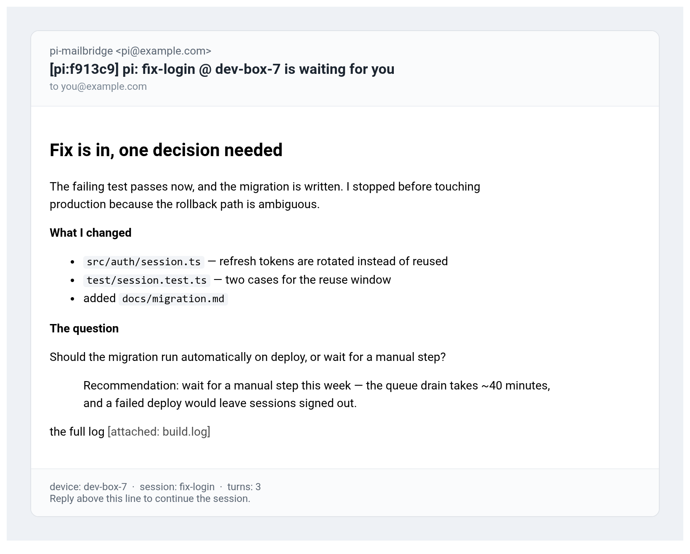

# pi-mailbridge

Answer your coding agent from your mailbox.

When a [pi](https://pi.dev) session needs a decision, it emails you. You reply from your phone,
your work laptop, a webmail tab — anything that can read mail — and **that same session
continues**, with your answer as the next message. Notifications also carry rendered Markdown,
screenshots inline, and any local file the agent linked, attached with its real name.



- **Your inbox is the client.** No app, no account, no relay, no push service. Any device with
  email works: a phone, a tablet, another PC, a webmail tab.
- **Reply = resume.** The reply is injected into the session that sent the mail, as a follow-up,
  so it queues correctly if a run is still in flight.
- **One mailbox connection per machine.** A small loopback daemon owns a single IMAP IDLE
  connection; every pi session is a thin client, so N sessions never race over one mailbox.
- **Explicit, not inferred.** Email mode is a switch: on while you are away, off when you are at
  the desk. No focus heuristics, no "probably idle".
- **Crash-safe.** Mail is marked seen only after the reply is delivered and acknowledged. A crash
  leaves it unread, so nothing is lost.

> **This turns your inbox into a control channel for an agent that can run shell commands.**
> Read [docs/SECURITY.md](./docs/SECURITY.md) before installing, and point it at a mailbox you
> would not mind an agent reading.

## Install

Requires **Node.js ≥ 22.6** (the package ships TypeScript and runs it with
`--experimental-strip-types`). `pi`'s own Node is fine.

```bash
pi install npm:pi-mailbridge
```

## Quick start

Inside pi:

```text
/mailbridge setup pi-you@example.com to you@example.com
```

`setup` discovers the provider's servers and auth from its published settings, so you never
hand-write hosts or ports. `to` is optional and defaults to the pi address — that selects the
single-mailbox layout, described below. It refuses to overwrite an existing config unless you
add `force`.

Setup cannot invent your password. It writes the config with an empty one and tells you where:

```text
~/.config/pi-mailbridge/config.json      # mail.imap.password, mail.smtp.password
```

Then prove it, once:

```text
/mailbridge check     # config shape, and that credentials are present (no network)
/mailbridge smoke     # one real mail out, then read the folder back
```

`check` cannot tell a wrong password from a right one; `smoke` is what proves the login. When
both are quiet:

```text
/mailbridge on        # email mode on
```

Let a turn settle and the first notification arrives. Reply to it from anywhere.

Prefer to write the config yourself? Copy [`config.example.json`](./config.example.json).

### Start watching from now

Do this **before your first `/mailbridge on`** if the mailbox already holds mail you do not want
the agent to read (a personal inbox, say):

```text
/mailbridge prime     # or: pi-mailbridge --prime
```

It moves the UID cursor to the newest message without fetching anything, so scanning starts at
the next arrival. Nothing is read, nothing is marked seen. It is a first-run step: once the
bridge has a cursor, `prime` refuses, because moving the cursor later would silently skip a reply
that arrived while nothing was scanning. (Setup starts the daemon in pi; headless `--setup` only
writes the file. Nothing is read while email mode is off.)

### Your first notification

```
Subject: [pi:f913c9] pi: fix-login @ dev-box-7 is waiting for you

Done: the failing test passes now.

--
device: dev-box-7
session: fix-login
project: /home/ybc/Work/proj
turns: 3

Reply above this line to continue the session.
```

Reply normally — plain Reply is enough. The subject id routes it back; `In-Reply-To` and
`References` are the fallback if the subject is edited. `/mailbridge off` closes the channel in
both directions: no notifications, and replies stay unread in the mailbox until you turn it on
again.

## One mailbox or two?

Two layouts work; pick before you start, because it changes the allowlist.

| | **A. Dedicated mailbox** (recommended) | **B. One mailbox** |
| --- | --- | --- |
| Who | pi gets its own address, you use yours | one address for both |
| `mail.to` | `you@example.com` | `you@qq.com` |
| `security.allowSelfReplies` | `false` (default) | `true` — required |
| `security.requireDmarcPass` | `true` (default) | `false` — setup writes this |
| Isolation | a compromised pi mailbox is not your inbox | none; point it at a mailbox you would not mind an agent reading |

### A. Dedicated mailbox

pi gets its own address; your personal address receives notifications and sends replies.

```text
mail.imap.user / mail.smtp.user = pi@example.com      # pi's mailbox
mail.to                          = you@example.com     # you
security.allowFrom               = ["you@example.com"]
security.allowSelfReplies        = false               # the default
```

### B. One mailbox (single personal account)

pi's mailbox *is* your address, so notifications land in your inbox and you reply from the same
address.

```text
mail.imap.user / mail.smtp.user = you@qq.com
mail.to                          = you@qq.com
security.allowFrom               = ["you@qq.com"]
security.allowSelfReplies       = true      # required, or every reply is a "self" loop
security.requireDmarcPass       = false     # see below; /mailbridge setup writes this
```

Three requirements keep this shape safe, and they constrain how you reply:

1. **A marker header.** Every notification carries `X-Pi-Mailbridge: notification`, and the
   scanner refuses that marker before anything else.
2. **Reply evidence.** A self-addressed message must carry `In-Reply-To` or `References`;
   **Reply (or Forward-then-Reply) is the only supported way in.** A freshly composed mail is
   rejected as `no-reply-evidence`.
3. **The outbound registry.** Our own `Message-ID`s are recorded when sending, so a copy of our
   own mail is recognised even if the marker was stripped.

**DMARC cannot work here**, and that is not a loophole to leave open by accident. A message from
your address to the same address is delivered by your own provider, and some (QQ is one) add no
`Authentication-Results` header at all. Requiring one rejects every genuine reply, so `setup`
turns it off when the addresses match and says so. What that costs: **DMARC is what would stop
someone forging your address.** With it off, a spoofed `From` passes the allowlist, so what keeps
a stranger out is **routing** — they would need a live `[pi:…]` route id they had read from one of
your notifications. If your provider does stamp `Authentication-Results` on self-mail you can set
it back to `true`, but `/mailbridge check` and `--check` then report the combination and exit
non-zero, and the shipped unit stops at `ExecStartPre`.

Once configured, prove it without pi:

```bash
pi-mailbridge --smoke     # sends one real mail, then opens the folder and counts
```


## Commands

| Command | Effect |
| --- | --- |
| `/mailbridge` or `/mailbridge status` | daemon health, mode, session, secret, mailbox, allowlist, pending replies |
| `/mailbridge on` | email mode on: decisions mail you and end the turn |
| `/mailbridge off` | email mode off: decisions ask in this terminal |
| `/mailbridge setup <pi-address> [to <your-address>] [force]` | discover servers + auth, write the config, start or reload the daemon |
| `/mailbridge check` | validate config and that credentials are *present* (no network in pi; `--check` runs your `tokenCommand` when XOAUTH2 is configured) |
| `/mailbridge auth` | start the OAuth2 device login |
| `/mailbridge smoke` | reload the daemon, send one real mail, read the folder back |
| `/mailbridge prime` | **first run only**: skip the mailbox's existing mail |
| `/mailbridge restart` | replace the daemon process (after an update) |
| `/mailbridge help` | the same list |

### Commands by mail

A reply whose body — after the quoted original and signature are stripped — is one command line
runs that command instead of being read by the agent. Useful when you are away and want the phone
to do something:

| Reply | Effect |
| --- | --- |
| `/mailbridge on` | email mode ON |
| `/mailbridge off` | email mode OFF; anything else in that batch stays pending until the next `on` |
| `/mailbridge` or `/mailbridge status` | the status panel |
| `/mailbridge check` / `/mailbridge smoke` | validate the config / send one test mail |
| `/mailbridge help` | the command list |

Output appears in the pi session, **not** in a reply mail. Four are deliberately **not** runnable
by mail — `/mailbridge setup`, `auth`, `restart` and `prime` — and anything longer than one line
is a message, so a quoted command never fires. The dispatch is ours, not pi's, so a refused
command cannot reconfigure the account even if someone forges your address.

### The headless entry point

For a systemd unit, a container, or a first run on a remote box:

| Flag | Effect |
| --- | --- |
| *(none)* | run the daemon in the foreground |
| `--setup <pi-address> [--to <your-address>] [--force]` | write the config and exit; nothing is started. Omitting `--to` selects the single-mailbox layout |
| `--check` | validate config and credential *presence*, exit non-zero on a problem; runs `tokenCommand` for XOAUTH2 |
| `--smoke` | send one real mail, read the folder back |
| `--auth` | OAuth2 device login |
| `--prime` | first-run cursor move; exits 2 if it has already run |
| `--print-token` | print the bearer secret to stdout — never paste it anywhere |

```bash
node --experimental-strip-types \
  "${PI_MAILBRIDGE_DIR:-$HOME/.pi/agent/npm/node_modules/pi-mailbridge}/src/daemon/main.ts"
```

On a system whose `env` lacks `-S` (busybox/Alpine), the `bin` shim fails with
`env: invalid option -- 'S'`; the explicit `node --experimental-strip-types …` form above is the
same program.

### What gets attached

A notification carries what it needs to be useful away from the desk:

| In the mail body | What arrives |
| --- | --- |
| `` | the image, inline, up to 5 MB each |
| `[the log](./build.log)` | `build.log` as an attachment, named after the file, listed as `the log [attached: build.log]` |

Up to 10 files, 15 MB each, 18 MB in total by default (`notify.maxAttachmentMb`). Attachments are
base64-encoded, which costs about a third, so the default stays under the smallest provider
ceiling:

| Provider | Per-message limit |
| --- | --- |
| Gmail (personal) | 25 MB sent, 50 MB received |
| Outlook.com / Hotmail | 25 MB |
| Microsoft 365 (work) | 35 MB sent by default; on-prem Exchange often 10 MB |
| QQ | 50 MB (+5 MB body), 200 MB/day |

Only allowlisted types are attached (`pdf txt log md csv json yml xml zip docx xlsx pptx`, plus
images), because the path comes from model output — a private key is never mailed because a prompt
asked for it.

## When it helps

- Long runs where the agent stops to ask something and you are not at the desk.
- Work you start and then leave — the decision reaches you wherever you are.
- Sending a screenshot or a log file as the answer instead of prose.

## When it does not

- **You need an answer now.** Mail latency is mail latency; there is no push channel.
- **The mailbox gets untrusted mail.** Everything in `security.allowFrom` can command the agent;
  keep the mailbox narrow.
- **You want a new session started from mail.** Not implemented: a reply resumes the session that
  asked. Starting a fresh one from a mail is a different architecture.
- **You need S/MIME or PGP.** Not implemented; transport encryption is the provider's.

## How a reply is identified

A reply is matched to a session by the first rule that succeeds:

| # | Rule | Survives | Notes |
| --- | --- | --- | --- |
| 1 | **Short route id** — `[pi:f913c9]`, matched anywhere in the subject | subject intact | What every notification carries. A lookup key in this machine's route table, not a credential: an id never minted here resolves to nothing. TTL-bounded. `Re:`, `RE:`, `Aw:`, `Re[2]:` are fine because the id is not anchored. |
| 2 | **Legacy signed token** — `[pi:<payload>.<mac>]` | subject intact | Still verified (HMAC, TTL-bounded) so older mail keeps working. New notifications no longer use it. |
| 3 | **The reply chain** — `In-Reply-To`, or any id in `References`, equals a Message-ID we recorded | subject edited, rewritten or purged | Recorded when the notification is sent, kept for the last 2,000 sends, aged out with `security.tokenTtlHours`. |
| 4 | None of the above | — | Rejected as `no-token`. The mail stays unread, but the cursor has passed it, so reply again rather than editing the old subject. |

Every rule is routing only. Authorization happens before it: the sender allowlist, plus DMARC
(off in the single-mailbox layout — see above).

- **Reply normally.** Mail clients set `In-Reply-To` or at least `References`; either is accepted.
- **Editing the subject is safe** — the chain still routes it until the TTL expires. On a
  provider that rewrites `Message-ID` (QQ does; `setup` names `Sent Messages` for
  `qq.com`/`foxmail.com`), set `mail.imap.sentFolder` or this fallback cannot match: the reply
  references an id the provider invented, not the one we recorded.
- **Composing a brand-new email** with no id and no reference is not identified.
- **Quoted text is stripped** before the agent sees it, so leave the quote in.
- **A reply to a reply** still works: the chain carries the original id.

Rule 3 is a convenience fallback, not authentication. Set `security.allowHeaderThreading: false`
to switch it off; the subject id is an unsigned lookup key either way.

## A reply did not arrive

Every scan records why each message was refused, so this is answerable:

```
/mailbridge status
```

```
mode: on
imap: connected
last scan with mail: 14:02:11 — examined 2, kept 1, rejected 1
rejections: not-allowlisted 1
```

A non-zero `rejected` count means mail was seen and not accepted. `handled:` lines are the
accepted paths, `attachments dropped:` is a partial loss, and a full queue defers rather than
discards. Counters of zero are omitted, so a quiet scan prints no scan line; while mode is off
nothing is scanned and the panel shows the previous scan, so `mode:` — not the scan time — is the
proof the channel is open.

| Reason | What it means | Fix |
| --- | --- | --- |
| `no-from` / `not-allowlisted` | no `From:`, or not an exact address in `security.allowFrom` | add the address you reply from |
| `allowlist-empty` | `security.allowFrom` is empty, which denies everything | set it |
| `dmarc-missing` / `dmarc-failed` | no `Authentication-Results` with `dmarc=pass` from a trusted relay | check `security.requireDmarcPass`; Microsoft consumer accounts need `trustedAuthservId` unset |
| `no-token` | the subject lost its `[pi:…]` id **and** no `In-Reply-To`/`References` matched | reply to the original mail |
| `route-miss` | the subject's id expired or was minted on another machine | nothing, if it routed by the chain — it appears under `handled:` |
| `other-device` | the notification came from another pi machine, or `device.name` changed | reply to a notification from this machine |
| `self` | single-mailbox mode with `security.allowSelfReplies: false` | set it `true` |
| `self-echo` | our own notification looping back — the guard working | nothing |
| `expired` | a queued reply aged out under queue pressure | send it again; the original never arrived |
| `no-reply-evidence` | a self-addressed mail with no threading headers | reply to the notification instead |
| `auto-generated` | a robot, mailing list or bounce | nothing |
| `empty-body` | no prose and no usable attachment | — |
| `attachment-*` | an attachment was dropped (type, size, count) | see the suffix |
| `pending-full` | 1 000 undelivered replies are queued | start a session so they drain |
| `too-large` | over 8 MiB, refused before the body was downloaded | send a smaller one; inbound attachments are capped at 4 files and 1 MB *in total* |

Where to look:

| Path | What it holds |
| --- | --- |
| `$XDG_STATE_HOME/pi-mailbridge/daemon.log` (default `~/.local/state/…`); under systemd, `journalctl --user -u pi-mailbridge` | scan summaries, connect errors, refusal reasons |
| `…/uid-cursor.json` | last seen UID + the mailbox UIDVALIDITY |
| `…/mode.json` | the global on/off state `/mailbridge on` and `off` write |
| `…/pending.json` | accepted replies waiting for a session |
| `…/routes.json` | short routing ids (`security.tokenTtlHours`) |
| `…/threads.json` | outbound Message-IDs for threading and the reply chain |
| `…/journal.json` | acked UIDs, tagged with the UIDVALIDITY |

If `imap:` says `disconnected`, the credentials or host are wrong even though the daemon is up —
the state a revoked app password leaves you in. If `/mailbridge status` says the daemon is
unreachable, `/mailbridge restart` both starts it and wires this session.

Allow up to a minute for a reply: the daemon sweeps on a timer (`daemon.scanIntervalSecs`,
default 60) as well as on IMAP events, because a provider can stop pushing them. `no mail yet —
last checked …` means it is polling and has seen nothing.

## Security

Gate order, all fail-closed: journal → our own marker header → size ceiling → `From:` present →
loop guard → auto-generated/bounce → sender allowlist → DMARC → our own Message-ID → routing →
durable ack. Routing identifiers never authorize anything: authorization is the allowlist and
DMARC alone (DMARC is off in single-mailbox mode). Prefer a dedicated account or a filtered
folder. What is stored, what a leaked token means, and the threat model in full:
[docs/SECURITY.md](./docs/SECURITY.md).

## Configuration

`~/.config/pi-mailbridge/config.json`, merged over built-in defaults, then `PI_MAILBRIDGE_*`
environment variables. A working example: [`config.example.json`](./config.example.json).

| Key | Default | Meaning |
| --- | --- | --- |
| `mail.imap.host` / `.port` / `.secure` | — / 993 / true | IMAP server |
| `mail.imap.user` | — | pi's mailbox account |
| `mail.imap.sentFolder` | — | where the account keeps sent mail (`Sent Messages` on QQ, `Sent Items` on Outlook). Set it when the provider rewrites the `Message-ID` we stamp — QQ does, and `setup` writes it for `qq.com`/`foxmail.com`. Costs one short-lived IMAP connection per notification; the copy must appear within about two minutes |
| `mail.imap.password` | — | password or app password for `LOGIN` |
| `mail.imap.folder` | `INBOX` | watched folder |
| `mail.imap.authType` | `LOGIN` | `LOGIN` or `XOAUTH2` |
| `mail.imap.tokenCommand` | `[]` | argv whose stdout is an access token |
| `mail.smtp.host` / `.port` / `.secure` | — / 465 / true | SMTP server |
| `mail.smtp.user` | — | also the `From:` and the loop-guard identity |
| `mail.smtp.password` | — | password or app password for `LOGIN` |
| `mail.smtp.authType` | `LOGIN` | `LOGIN` or `XOAUTH2` |
| `mail.smtp.tokenCommand` | `[]` | argv whose stdout is an access token |
| `mail.to` | — | **your** address: where notifications go |
| `oauth.issuer` | — | OAuth2 discovery base URL |
| `oauth.clientId` | — | your app registration's client id |
| `oauth.clientSecret` | — | confidential clients only; omit for device code |
| `oauth.scope` | — | must include `offline_access` for a refresh token |
| `device.name` | hostname | machine name in settle notifications and routing records |
| `security.allowFrom` | `[]` | senders allowed to command the agent; empty denies all |
| `security.requireDmarcPass` | `true` | require a DMARC pass, pinned to `trustedAuthservId` when set. `false` for a single mailbox unless your provider stamps `Authentication-Results` on self-mail |
| `security.trustedAuthservId` | unset | pin the trusted `Authentication-Results` host; leave unset for Microsoft consumer accounts |
| `security.allowHeaderThreading` | `true` | accept a reply whose subject id was lost, by matching `In-Reply-To`/`References` |
| `security.allowSelfReplies` | `false` | one address for both roles: accept a self-addressed message, but only a real reply |
| `security.tokenTtlHours` | `720` | lifetime of a route id, signed token and reply-chain entry |
| `daemon.host` / `.port` | `127.0.0.1` / `4177` | loopback HTTP; the port is the instance lock |
| `daemon.exitWhenIdle` | `true` | exit once no pi session pings; `false` for a supervised daemon |
| `daemon.idleTimeoutSecs` | `120` | grace period after the last ping |
| `daemon.scanIntervalSecs` | `60` | catch-up scan while mode is on, so a silent IDLE cannot strand a reply; `0` disables |
| `notify.onSettled` | `true` | email when an agent settles |
| `notify.debounceMs` | `10000` | quiet period before the settle mail |
| `notify.notifyOnAborted` | `false` | also mail when you hit Escape |
| `notify.maxAttachmentMb` | `18` | total size of files attached to one notification, before base64. Default sits under Gmail/Outlook.com's 25 MB; QQ allows 50 MB, so a QQ account can raise it |
| `tuning.idleRenewMs` | `1500000` | IDLE renew interval (keep under ~29 min) |
| `tuning.backoffInitialMs` / `.backoffMaxMs` | `1000` / `60000` | reconnect backoff bounds |

### Provider support

| Provider | Auth | Status |
| --- | --- | --- |
| Any IMAP/SMTP host (self-hosted, Posteo, Fastmail, Zoho…) | `LOGIN` — account or app password | ✅ works |
| **QQ Mail / Foxmail** | `LOGIN` 授权码 | ✅ built-in discovery; QQ accounts must be 14 days old before IMAP/SMTP can be enabled |
| **163 / 126 / yeah.net / 188.com** | `LOGIN` 授权码 | ✅ built-in discovery; no waiting period |
| Gmail | app password (`LOGIN`) | ✅ works |
| Microsoft 365 / work accounts | `XOAUTH2` | ✅ usually works |
| **Personal** `@outlook.com` / `@hotmail.com` | `XOAUTH2` only | ⚠️ app passwords are rejected over IMAP — see below |

**Outlook needs OAuth2, not a password.** Enabling IMAP/SMTP in the settings does not restore
password login. The package ships a device-code flow:

```bash
pi-mailbridge --check     # tells you exactly what is missing
pi-mailbridge --auth      # prints a URL + code, waits for approval
```

```json
"oauth": {
  "issuer": "https://login.microsoftonline.com/consumers/v2.0",
  "clientId": "<application (client) id>",
  "scope": "offline_access https://outlook.office.com/IMAP.AccessAsUser.All https://outlook.office.com/SMTP.Send"
}
```

Registering the app is free and takes about two minutes (Entra → *Allow public client flows*).
Walkthrough, scope tables and the Gmail equivalent: [docs/OAUTH.md](./docs/OAUTH.md).

**In mainland China, use QQ or 163** — 授权码 works exactly like an app password:

```text
/mailbridge setup pi-you@qq.com to you@hotmail.com
```

Then paste the 授权码 into both password fields and `/mailbridge smoke`. `setup` writes
`mail.imap.sentFolder: "Sent Messages"` for `qq.com`/`foxmail.com`, because QQ replaces the
`Message-ID` we stamp; add it by hand for any other provider that rewrites ids.

**Elsewhere, Gmail with an app password** is the path with fewest moving parts: no OAuth app, no
tenant, no refresh token that dies weekly. Gmail *OAuth* is the harder route — restricted scopes
(verification + CASA) and consent screens in Testing expire refresh tokens every 7 days.

**Personal Outlook has a real caveat:** Microsoft sometimes rejects IMAP/SMTP OAuth2 even with a
valid token (`User is authenticated but not connected`, `SmtpClientAuthentication is disabled`).
That is their side. The reliable answer is Microsoft Graph, which is not implemented here yet;
[docs/OAUTH.md](./docs/OAUTH.md) explains the options, including turnkey services.

### A token command instead

If you already run a broker, `oauth.*` takes precedence over `tokenCommand` — remove the `oauth`
block to use it:

```json
"authType": "XOAUTH2",
"tokenCommand": ["ortie", "token", "show", "-a", "outlook"]
```

Three consecutive failures disable OAuth2 for the session rather than spawning a failing process
on every scan; a single transient failure is retried.

## Environment overrides

Config values can be overridden per-process — this is how the shipped systemd unit stays resident
without editing your config file:

| Variable | Sets |
| --- | --- |
| `PI_MAILBRIDGE_IMAP_HOST`, `PI_MAILBRIDGE_IMAP_USER`, `PI_MAILBRIDGE_IMAP_PASS` | `mail.imap.host`, `.user`, `.password` |
| `PI_MAILBRIDGE_SMTP_HOST`, `PI_MAILBRIDGE_SMTP_USER`, `PI_MAILBRIDGE_SMTP_PASS` | `mail.smtp.host`, `.user`, `.password` |
| `PI_MAILBRIDGE_TO` | `mail.to` |
| `PI_MAILBRIDGE_PORT` | `daemon.port` |
| `PI_MAILBRIDGE_DEVICE` | `device.name` |
| `PI_MAILBRIDGE_EXIT_WHEN_IDLE` | `daemon.exitWhenIdle` (`false` for a supervised daemon) |
| `PI_MAILBRIDGE_IMAP_TOKEN_CMD`, `PI_MAILBRIDGE_SMTP_TOKEN_CMD` | `mail.imap.tokenCommand`, `mail.smtp.tokenCommand` (argv list; JSON or comma-separated) |

### Running it under systemd

A unit ships in [`docs/systemd/pi-mailbridge.service`](./docs/systemd/pi-mailbridge.service).
Three things the unit cannot guess:

```bash
mkdir -p ~/.local/state/pi-mailbridge      # the unit cannot create it (ProtectHome)
systemctl --user daemon-reload
systemctl --user enable --now pi-mailbridge
```

The unit sets `PI_MAILBRIDGE_EXIT_WHEN_IDLE=false`, because a supervised daemon must not exit on
its own, and `Restart=on-failure`, so the clean "another daemon owns the port" exit does not
loop.

## Agent tools

| Tool | Behaviour |
| --- | --- |
| `request_decision` | Emails a question with optional options and a recommendation, then ends the turn. One outstanding decision per session. Ending the turn is a convention, not an enforced gate — see [docs/SECURITY.md](./docs/SECURITY.md) §3. |
| `notify_user` | One-way update. Does not reserve a slot and does not wait. |

Both refuse cleanly when email mode is off or the daemon is unreachable.

## Turning it off for good

`/mailbridge off` closes the channel but leaves everything installed. To remove it:

```bash
# 1. the daemon (skip if you never installed the unit)
systemctl --user disable --now pi-mailbridge
rm -f ~/.config/systemd/user/pi-mailbridge.service
systemctl --user daemon-reload

# 2. the package — the reverse of however you installed it, e.g.
#    pi remove npm:pi-mailbridge

# 3. everything it wrote: credentials, routing ids, queued replies
rm -rf ~/.local/state/pi-mailbridge ~/.config/pi-mailbridge
```

Nothing is installed system-wide: the daemon runs as you, binds loopback, and its state is the
two directories above. If you created an Entra app or a provider app password, revoke those too —
that is the credential that actually reaches your mailbox.

## How it works

```
IMAP IDLE ──► scan (UID cursor) ──► authorize ──► route ──► strip quote ──► persist
                                                                     │
                     pi session ◄── claim ◄── poll ◄─────────────────┘
                          │
                          └──► inject as followUp ──► ack ──► \Seen + journal
```

One daemon per machine owns the mailbox; sessions never touch IMAP. `smoke` and `prime` are the
deliberate exceptions — each opens one short-lived connection. Design notes, the failure-mode
table and the module map: [docs/ARCHITECTURE.md](./docs/ARCHITECTURE.md) and
[docs/MAPPING.md](./docs/MAPPING.md).

## Status

`0.1.0` — feature-complete for the single-user, one-mailbox case, and exercised end to end
against a live QQ mailbox in both layouts: two addresses (DMARC verified on the reply) and one
address for both roles (self-delivery, the self-echo guard, and a reply routed by the chain).

What that does not buy you: there is **no automated live-mailbox test**. Provider behaviour is
observed, not guaranteed — a provider can change how it rewrites headers or pushes `EXISTS`. The
hermetic suite covers the token, authz, scan pipeline, stores, daemon HTTP surface, lifecycle,
extension surface, tools, attachments and the full end-to-end loop; it needs no network, no
mailbox and no socket.

Not implemented: starting a *new* session from mail, and MIME/S-MIME.

## License

MIT
